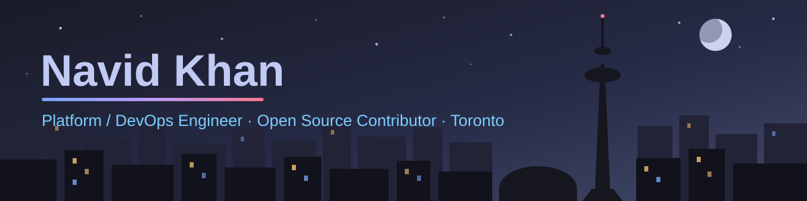
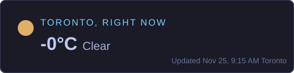
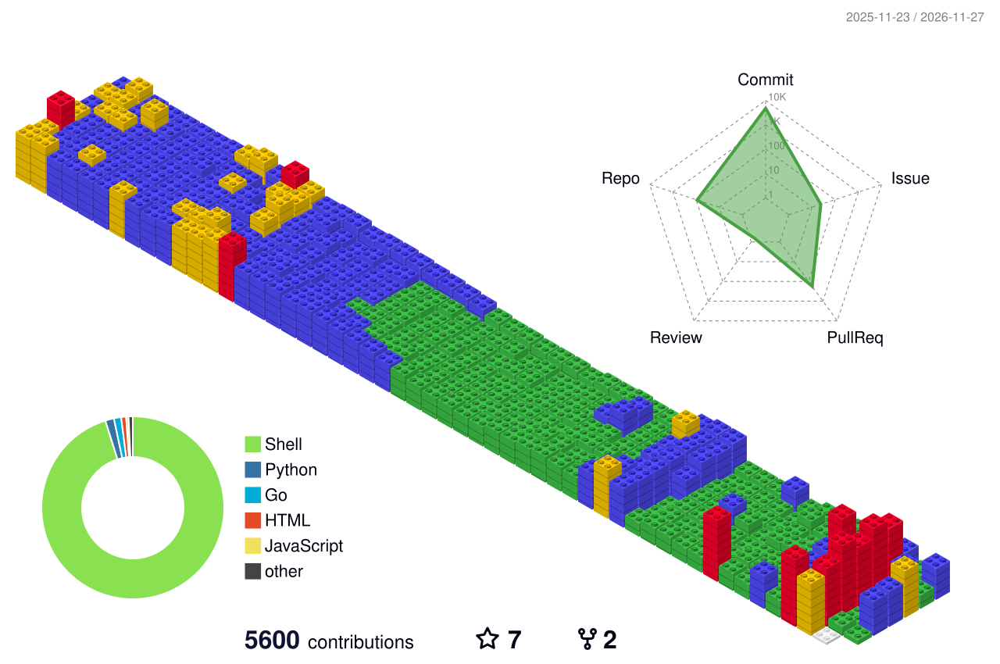

<div align="center">




**Toronto 🇨🇦 engineer wearing five hats: QA automation, DevOps, software development, ML/AI, and architecture, with FinOps across all of it. I build infrastructure tooling, revive abandoned projects, and contribute to open source.**

</div>

<div align="center">



</div>

```console
$ whoami
navid-khan
$ navid --summary
roles      QA Automation · DevOps · Developer · ML/AI · Architect
also       FinOps and platform engineering across all of it
location   Toronto, Canada
code       Go · Python · TypeScript · Java
focus      Terraform, Kubernetes, test automation, cloud cost, AI tooling
currently  reviving Terraformer, hunting bugs with property-based tests
```

---

## 🧠 About Me

- 🔧 DevOps and platform engineering: cloud infrastructure, Kubernetes, and the tooling around them
- 🧪 QA automation: Selenium and TestNG frameworks, CI test pipelines, and property-based testing
- 💰 FinOps: cloud and AI spend visibility, budgets, and cost controls
- 🤖 ML/AI: RAG pipelines, LLM tooling and evaluation, and AI cost governance
- 🏛️ Architecture: system design for cloud platforms, test infrastructure, and AI tooling
- 🐹 Mostly Go, Python, TypeScript, and Java these days
- 🌍 Open-source contributor with merged PRs in projects like **external-dns**, **Argo CD**, **emissary-ingress**, **rclone**, **Prometheus**, and **Storybook**
- 🛠️ I like tools that catch real bugs: property-based testing, security scanning, and CI gates
- 🎯 Current focus: making infrastructure imports and CI checks boringly reliable

## 🏆 Upstream, Merged

Pull requests I have landed in other people's projects, verified against the GitHub API:

<div align="center">


</div>

| Project | Merged PRs |
| --- | --- |
| [](https://github.com/kubernetes-sigs/external-dns) | [#6790](https://github.com/kubernetes-sigs/external-dns/pull/6790) · [#6791](https://github.com/kubernetes-sigs/external-dns/pull/6791) |
| [](https://github.com/argoproj/argo-cd) | [#30572](https://github.com/argoproj/argo-cd/pull/30572) · [#30855](https://github.com/argoproj/argo-cd/pull/30855) · [#30884](https://github.com/argoproj/argo-cd/pull/30884) |
| [](https://github.com/emissary-ingress/emissary) | [#6015](https://github.com/emissary-ingress/emissary/pull/6015) |
| [](https://github.com/rclone/rclone) | [#10206](https://github.com/rclone/rclone/pull/10206) · [#10289](https://github.com/rclone/rclone/pull/10289) |
| [](https://github.com/prometheus/prometheus) | [#20302](https://github.com/prometheus/prometheus/pull/20302) |
| [](https://github.com/storybookjs/storybook) | [#37348](https://github.com/storybookjs/storybook/pull/37348) · [#37374](https://github.com/storybookjs/storybook/pull/37374) |
| [](https://github.com/nrwl/nx) | [#37860](https://github.com/nrwl/nx/pull/37860) |

## ⚡ Recent Activity

What I have been shipping lately, updated automatically:

<!--START_SECTION:activity-->
1. 💪 Opened PR [#10975](https://github.com/stanfordnlp/dspy/pull/10975) in [stanfordnlp/dspy](https://github.com/stanfordnlp/dspy)
<!--END_SECTION:activity-->

## 🚀 Featured Projects

- **[Terraformer](https://github.com/Sun-Wukhan/terraformer)**: revived fork of Google's archived Terraformer (reverse Terraform: import existing cloud resources into HCL + state). Releases shipping, GCP / AWS / Azure coverage rebuilt
- **[pickle-sentry](https://github.com/Sun-Wukhan/pickle-sentry)**: scanner that catches dangerous pickle deserialization in ML models and codebases. On PyPI and the GitHub Marketplace
- **[pbt-sentry](https://github.com/Sun-Wukhan/pbt-sentry)**: property-based test runner as a GitHub Action: deterministic seed ranges, deduped failure signatures, exact repro commands
- **[semantic-gate](https://github.com/Sun-Wukhan/semantic-gate)**: CI gate for semantic drift in dbt projects: catches definition changes that alter meaning without changing schema
- **[peer-trust-network](https://github.com/Sun-Wukhan/peer-trust-network)**: peer-to-peer trust network: Web-of-Trust PKI with in-person attestations and a public trust score

<table>
  <tr>
    <td><a href="https://github.com/Sun-Wukhan/terraformer"></a><br />  </td>
    <td><a href="https://github.com/Sun-Wukhan/pickle-sentry"></a><br />  </td>
  </tr>
  <tr>
    <td><a href="https://github.com/Sun-Wukhan/pbt-sentry"></a><br />  </td>
    <td><a href="https://github.com/Sun-Wukhan/semantic-gate"></a><br />  </td>
  </tr>
</table>

---

## 🛠️ Tech Stack

### 💻 Languages & Frameworks


### ☁️ Cloud & Platforms


### 🚀 CI/CD & GitOps


### 🧪 Testing & Quality


### 📈 Observability


### 🗄️ Data & Messaging


### 🤖 ML/AI & MLOps


### 🔧 Tools


## 📜 Certifications

[](https://www.credly.com/badges/ef685ac4-e0f7-4ec8-bac5-38a4ae4b6509/public_url)
[](https://google.accredible.com/621b86af-732e-4df1-919b-ee7c7ee250cb)
[](https://www.credly.com/badges/09fa2150-0c0c-40cb-b1a6-3563835d6d83/public_url)
[](https://learn.microsoft.com/en-us/users/alikhan-9532/credentials/7fe09ed0ea4478f4?ref=https%3A%2F%2Fwww.linkedin.com%2F)
[](https://www.credly.com/badges/e6d40b33-9857-42da-8046-99bc305c75c5/public_url)


---

## 🔭 Currently Working On

- Terraformer: more provider coverage, safer imports, and a friendlier import wizard
- Property-based testing hunts against large Go and Python codebases
- AI agent tooling: control planes, evaluation, and cost visibility

## 🌱 Currently Learning

- Advanced property-based testing patterns and shrinking strategies
- AI-driven engineering workflows and agent evaluation
- Deeper Kubernetes internals and controller patterns

## 🤝 Open To Collaborate On

- Infrastructure and platform tooling
- Open-source DevOps projects that need a hand with CI, testing, or cloud providers
- Developer tools with a security or reliability angle

## 💬 Ask Me About

- Terraform and importing real-world cloud infrastructure
- Kubernetes, CI/CD, and GitHub Actions
- Selenium, TestNG, and making test suites fast and trustworthy
- Cloud and AI spend: FinOps, budgets, and cost visibility
- Getting your first PR merged in a big open-source project

---

## 📊 GitHub Statistics

<div align="center">


</div>

### 🔥 Contribution Streak

<div align="center">


</div>

### 📈 Activity Graph

<div align="center">


</div>

### 🏙️ Contribution City

<div align="center">



</div>

---

## 🐍 Contribution Snake

<div align="center">

<picture>
  <source media="(prefers-color-scheme: dark)" srcset="https://raw.githubusercontent.com/Sun-Wukhan/Sun-Wukhan/output/github-contribution-grid-snake-dark.svg" />
  <source media="(prefers-color-scheme: light)" srcset="https://raw.githubusercontent.com/Sun-Wukhan/Sun-Wukhan/output/github-contribution-grid-snake.svg" />
  
</picture>

</div>

## 👾 Pac-Man Contribution Graph

<div align="center">

<picture>
  <source media="(prefers-color-scheme: dark)" srcset="https://raw.githubusercontent.com/Sun-Wukhan/Sun-Wukhan/output/pacman-contribution-graph-dark.svg" />
  <source media="(prefers-color-scheme: light)" srcset="https://raw.githubusercontent.com/Sun-Wukhan/Sun-Wukhan/output/pacman-contribution-graph.svg" />
  
</picture>

</div>

## 🎮 Tic-Tac-Toe: play against the internet

Click any empty square. It opens a pre-filled issue; press Submit and the board updates itself. You are whoever's turn it is; wins are credited to your GitHub name.

<!-- TTT:START -->

| | A | B | C |
| --- | --- | --- | --- |
| **1** | ❌ | [⬜](https://github.com/Sun-Wukhan/Sun-Wukhan/issues/new?title=ttt%3A%20move%20B1) | ❌ |
| **2** | [⬜](https://github.com/Sun-Wukhan/Sun-Wukhan/issues/new?title=ttt%3A%20move%20A2) | ❌ | ⭕ |
| **3** | [⬜](https://github.com/Sun-Wukhan/Sun-Wukhan/issues/new?title=ttt%3A%20move%20A3) | [⬜](https://github.com/Sun-Wukhan/Sun-Wukhan/issues/new?title=ttt%3A%20move%20B3) | ⭕ |

**Turn:** ⭕ (O) to move · **Game #1**
**Last move:** @Sun-Wukhan took C1 as X

**Scoreboard (wins):** no wins yet, be the first.
**Draws:** 0

<!-- TTT:END -->

---

<div align="center">


**Thanks for stopping by. The snake ate my contributions, but the PRs are real.** 🐍

</div>
